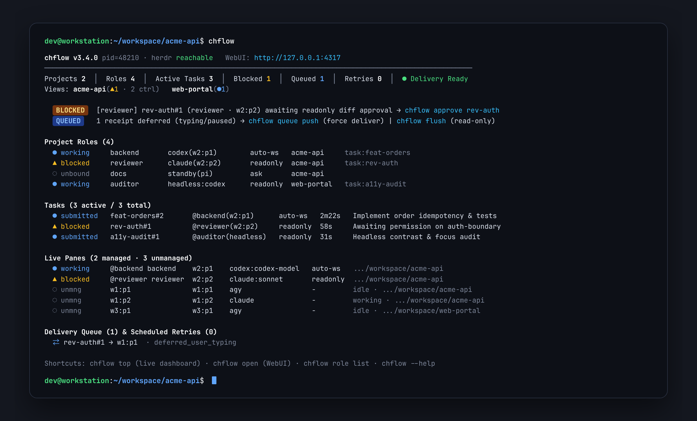

# cross-harness-flow (`chflow`)

**Herdr-Based Multi-Project, Role-Oriented Cross-Harness Agent Orchestrator**

[简体中文](./README.md) · English

[](#installation)
[](#dependencies--herdr-coupling)
[](#dependencies--herdr-coupling)
[](./LICENSE)

[Quick Start](#quick-start) · [Previews](#previews) · [Key Features](#key-features) · [Dependencies & Herdr Coupling](#dependencies--herdr-coupling) · [Installation](#installation) · [Stable Roles & Multi-Project Views](#stable-roles--multi-project-views) · [Web Console & CLI Dashboard](#web-console--cli-dashboard) · [Project-Scoped MCP](#project-scoped-mcp)

---

`cross-harness-flow` is a reusable **Agent Skill + runtime (`chflow` v3.4.0)** fundamentally **designed around [Herdr](https://github.com/herdrdev/herdr)** for local multi-agent orchestration. Built on Herdr's multi-pane terminal control plane, it unifies **Pi, Codex, Claude Code, and Antigravity** behind a single `.chflow/` file mailbox, a lazily started per-user Daemon, stable project roles, and real-time Web/CLI operator surfaces (while also supporting standalone headless runs), letting controller agents delegate by role and hot-swap underlying sessions or models while keeping human oversight and approvals effortless.

## Quick Start

### Starter Prompt for Your Controller Agent (Recommended)

Paste this prompt into any controller agent (Pi, Codex, Claude Code, or Antigravity) from any workspace to check/install dependencies and start role-based orchestration:

```text
Use cross-harness-flow (chflow) with Herdr to coordinate multi-agent work in my current workspace:
- Repo & setup docs: https://github.com/Raix2215/cross-harness-flow (interactive orchestration requires Herdr: https://github.com/herdrdev/herdr)
1. Check whether chflow, herdr, and the cross-harness-flow skill are installed locally; if missing, install them with user-level permissions from the repo (or Releases) per its README and load the skill.
2. Before spawning workers, confirm the project roles (e.g., backend, reviewer), target Harness/model for each role, git worktree isolation, and permission tier (default: ask).
3. Once confirmed, create and bind roles with chflow role set/bind, exchange briefs/results via the .chflow/ mailbox, and summarize for review.
```

### CLI Essentials

```sh
# Define & bind project roles (--worktree automatically isolates a workspace)
chflow role set backend  --kind codex  --perm auto-workspace --worktree --desc "Backend implementation & tests"
chflow role set reviewer --kind claude --perm readonly       --desc "Cross-harness code review"
chflow role bind backend --spawn && chflow role bind reviewer --spawn

# Dispatch by role (hot-swap sessions/models anytime via role bind --spawn while keeping --task)
chflow send backend  --brief-file backend-brief.md
chflow send reviewer --brief-file review-brief.md --wait --timeout 180

# Finish & prune (one-shot headless without Herdr: chflow run --kind codex --perm readonly --brief-file audit.md)
chflow finish <task-id> --ok --note "Review and regression checks passed" && chflow prune --tasks
```

---

## Previews

### Daemon-Embedded Multi-Project Role Topology Console (WebUI)

The embedded Web console starts automatically with the per-user Daemon (default `http://127.0.0.1:4317`, with automatic free-port fallback). Featuring a responsive percentage-width layout, comfortable typography, and crisp inline SVG icons (zero emojis), it offers a **full-width zero-crossing DAG dispatch canvas & card-grid switcher**, a conditional "Needs Attention" focus strip, a slide-over detail drawer (one-click session hot-swap, live permission tiers, redacted terminal inspection, mailbox turns), and an explicit topbar **"Stop Service"** control.


### Zero-Read-Screen CLI Live Status & Terminal Dashboard (`chflow` / `chflow top`)

Run `chflow` in an interactive terminal to inspect projects, role bindings, active tasks, live panes, and the embedded WebUI URL. Run `chflow top` (or `chflow status -w`) for a push-driven live terminal dashboard without reading worker screens.



---

## Key Features

- **Stable Project Roles & Hot Session Swapping (`chflow role`)**: Decouple long-lived project responsibilities (such as `backend`, `reviewer`, `docs`) from transient Harness panes. When quota runs out or you want a different model/Harness, run `role bind` to hot-swap the underlying pane or switch to a headless runner while preserving the task thread (`--task`) and `.chflow/` mailbox history.
- **Multi-Project & Multi-Controller Views (`--project`)**: Three-tier project resolution precedence: explicit assignment (`--project`, WebUI override, or optional `.chflow/project.yaml`) > Git linked worktrees merged into their primary repository (independent nested repos remain separate) > normalized working directory fallback. Multiple controllers can collaborate concurrently within the same project, each receiving its own receipts.
- **Strict Live State Sync with Herdr**: Treats Herdr `agent list` (`pane_id` + `terminal_id` + active running state) as the single source of truth. Whether a pane is closed or its inner agent session exits (`exited` while the Herdr pane remains open), temporary panes auto-prune immediately, idle role bindings revert to `unbound` standby, active-task offline panes explicitly report `offline`, and `chflow prune [--tasks]` cleans stale records on demand.
- **Predictable Daemon Lifecycle & Explicit Shutdown**: Supports two-tier idle auto-exit — exiting after `CHFLOW_IDLE_TIMEOUT_SEC` (default 30 min) with no clients, or after `CHFLOW_UI_IDLE_TIMEOUT_SEC` (default 60 min) when only passive WebUI tabs remain with zero live sessions or active tasks (emitting an SSE `shutdown` event so browsers stop reconnecting). Explicit stop controls are available via `chflow stop` / `chflow quit` (guarded against active tasks unless `--force`), the WebUI topbar "Stop Service" button, and `x` (twice) in `chflow top`.
- **Context-Clean File Mailbox Protocol**: Briefs and deliverables are written to workspace `.chflow/tasks/<task>/t<N>-brief.md` and `t<N>-reply.md` (automatically ignored via `.git/info/exclude`), while cross-pane wakeups inject only 3–5 plain-text lines of routing metadata and file paths.
- **Non-Intrusive Delivery & Minimal Screen Reads**: Receipts queue and debounce while a recipient pane is busy. When a focused pane has active typing or a bottom-line draft, delivery defers (`deferred_user_typing`) and can be inspected/consumed cleanly via `chflow inbox` / `chflow flush`. Routine monitoring never reads screens; on `blocked`, the Daemon captures at most one redacted diagnostic snapshot per state sequence.
- **Smart Retries & Compliant Fallbacks**: Defaults to 4-step exponential backoff with `--retry-after` / `--at` scheduled recovery and ordered `--fallback` chains (automatically filtering out the primary channel, and only showing fallback nodes in WebUI during active `retrying` / `scheduled_retry`), while clearly separating attended (`--attended`) and unattended automation boundaries.
- **Lightweight Human Overrides**: Human TTY shortcuts (`chflow open`, `approve`, `perm`, `queue`, `view`) stay outside the Agent MCP schema, while the WebUI provides live permission switching, direct terminal control, and per-event queue overrides.

---

## Dependencies & Herdr Coupling

Interactive orchestration in `cross-harness-flow` is **built directly on [Herdr](https://github.com/herdrdev/herdr)**. The `chflow` runtime itself uses only the Node.js standard library (including built-in SQLite) with no third-party npm runtime dependencies:

| Dependency | Version | Required | Role & Coupling Boundary |
| --- | --- | --- | --- |
| **[Herdr](https://github.com/herdrdev/herdr)** | `>= 0.9.5` | **Required for interactive orchestration** (optional for headless mode) | Manages interactive multi-pane terminal sessions, status probing, text injection, controlled keypresses, and cross-host SSH routing. All Herdr calls are isolated in a single adapter: [`packages/chflow/src/herdr.ts`](./packages/chflow/src/herdr.ts). |
| **Node.js** | `>= 22.13.0` | **Required** | Runs the `chflow` CLI, per-user Daemon, SQLite store, Stdio MCP server, and embedded WebUI. |
| **Harness CLI** | Authenticated | **As needed** | At least one target agent CLI (`codex`, `claude`, `pi`, or `agy`) available on `PATH`. |

> **What runs without Herdr?**
> Even without Herdr installed or running, one-shot/background headless runs (`chflow run --kind codex|claude|pi`), `chflow daemon`, SQLite state persistence, `.chflow/` file mailboxes, and the embedded Web console operate standalone.

---

## Repository Layout

```text
cross-harness-flow/
├── README.md                              # Chinese documentation (default)
├── README.en.md                           # English documentation
├── LICENSE                                # MIT License
├── assets/
│   ├── webui-preview.png                  # WebUI multi-project role topology preview (Chinese)
│   ├── webui-preview-en.png               # WebUI multi-project role topology preview (English)
│   ├── cli-dashboard.png                  # CLI live status dashboard preview (Chinese)
│   └── cli-dashboard-en.png               # CLI live status dashboard preview (English)
├── packages/chflow/                       # chflow v3.4.0 runtime source & black-box E2E suite
│   ├── LICENSE
│   ├── README.md
│   ├── package.json
│   ├── src/                               # TypeScript source
│   └── e2e/                               # Process-level black-box E2E & packaging checks
├── skills/
│   ├── README.md                          # Skill directory overview
│   ├── cross-harness-flow.skill           # Distributable Skill ZIP archive
│   └── cross-harness-flow/
│       ├── SKILL.md                       # Cross-Harness orchestration skill entrypoint
│       └── references/operations.md       # Command reference, MCP templates & troubleshooting
└── templates/
    └── matrix.template.yaml               # Sanitized multi-channel routing matrix template (v2)
```

---

## Installation

### 1. Install the `chflow` Runtime (User Permissions, No `sudo`)

```sh
cd packages/chflow
npm ci
npm run build
npm install -g --prefix "$HOME/.local" .
```

Ensure `$HOME/.local/bin` is on `PATH`. With **pnpm (including pnpm 12+)** and a user-configured global bin directory, pack first and install offline:

```sh
cd packages/chflow
npm ci && npm run build && npm pack
pnpm add -g --offline ./chflow-3.4.0.tgz
```

For cross-machine offline distribution, copy `chflow-3.4.0.tgz` to the target host and run:

```sh
# Linux / Unix
npm install --offline -g --prefix "$HOME/.local" ./chflow-3.4.0.tgz

# Windows (PowerShell, with a user-writable npm prefix on PATH)
npm install --offline -g .\chflow-3.4.0.tgz
```

### 2. Install the Skill

Copy [`skills/cross-harness-flow/`](./skills/cross-harness-flow/) (or extract [`skills/cross-harness-flow.skill`](./skills/cross-harness-flow.skill)) into your host's Skill directory (compatible with Pi, Codex, Claude Code, and Antigravity).

### 3. Verify Installation

```sh
chflow --version
chflow health
```

---

## Stable Roles & Multi-Project Views

### Optional Project Manifest (`.chflow/project.yaml`)

Place an optional `.chflow/project.yaml` at your repository root (metadata only — never store secrets or emails) to pin the project identity, group linked worktrees, and preload role slots:

```yaml
project: acme-api
name: Acme API
roles:
  backend:
    description: Core backend implementation and integration tests
    kind: codex
    perm: auto-workspace
    worktree: true
  reviewer:
    description: Cross-harness security and diff review
    kind: claude
    perm: readonly
```

- Without `.chflow/project.yaml`, `chflow` automatically groups sessions by **Git linked worktree → normalized working directory**.
- Calling `chflow send <role>` on an `unbound` role returns `role_unbound` by default to prevent accidental quota spend; pass `--spawn` explicitly to launch and bind from the role's preset.

---

## Web Console & CLI Dashboard

- **Always-On Embedded WebUI**: Starts automatically with the Daemon at `http://127.0.0.1:4317` (falling back to a free port on conflict).
- **Interactive CLI Controls**:
  - `chflow` / `chflow status [--project ID]`: compact colored global status and WebUI URL
  - `chflow top [--project ID]`: push-driven live terminal dashboard (`q` quit, `o` open WebUI, `a` approve block, `p` switch perm, `f` flush queue, `r` refresh, `x` twice to stop Daemon)
  - `chflow stop [--force]` / `chflow quit`: explicitly stop the background Daemon (guards active tasks unless `--force`)
  - `chflow open` / `chflow ui --open`: launch the embedded console in your default browser
  - `chflow approve` / `perm` / `queue` / `view`: human TTY-only operator shortcuts
- **Secure LAN / Tailnet Access**:
  - Launch a temporary standalone listener (leaves the shared Daemon unchanged):
    ```sh
    chflow ui --host 0.0.0.0 --allow-remote
    ```
  - Switch the shared Daemon to remote listening (confirm no active tasks first, stop the Daemon, then restart with environment variables):
    ```sh
    chflow daemon stop
    CHFLOW_UI_HOST=0.0.0.0 CHFLOW_UI_ALLOW_REMOTE=1 chflow daemon start
    ```
  - Non-loopback binding enforces a 48-hex-character Access Token, `HttpOnly; SameSite=Strict` cookie sessions, and strict `Host` / `Origin` / CSRF checks. **Security Note**: printed `?token=...` URLs are reusable access credentials — use them only on trusted networks and never share or log them publicly.

---

## Project-Scoped MCP

`chflow mcp` exposes a compact Stdio MCP proxy sharing the same Daemon (**19 default core tools**, including `flow_role`, `flow_adopt`, `flow_handoff`, `flow_inbox`, and `flow_flush`). The high-risk keypress tool `flow_respond` stays hidden unless explicitly enabled with `--enable-respond`.

<details>
<summary><b>Claude Code (<code>.mcp.json</code>) & Antigravity (<code>.agents/plugins/</code>)</b></summary>

```json
{
  "mcpServers": {
    "cross-harness-flow": {
      "command": "chflow",
      "args": ["mcp"]
    }
  }
}
```

For Antigravity, include `plugin.json` alongside it: `{ "name": "cross-harness-flow" }`.

</details>

<details>
<summary><b>Codex (<code>.codex/config.toml</code>)</b></summary>

```toml
[mcp_servers.cross_harness_flow]
command = "chflow"
args = ["mcp"]
```

</details>

<details>
<summary><b>Pi (<code>.pi/mcp.json</code>)</b></summary>

```json
{
  "mcpServers": {
    "cross-harness-flow": {
      "command": "chflow",
      "args": ["mcp"],
      "exposure": "codemode"
    }
  }
}
```

</details>

See [skills/cross-harness-flow/references/operations.md](./skills/cross-harness-flow/references/operations.md) for complete host setup and troubleshooting.

---

## Security & Compliance

- **Zero Credential Persistence**: [`templates/matrix.template.yaml`](./templates/matrix.template.yaml) and `.chflow/` mailboxes store only logical channel IDs and capabilities; built-in sensitive-input guards block literal API keys, tokens, cookies, and emails.
- **Human-in-the-Loop Boundary**: Explicitly separates attended interactive sessions (`--attended`) from unattended automation; consumer interactive OAuth channels stay attended-only and are excluded from `--unattended`, `--bg`, automatic retries, and automatic fallback chains.
- **Four Permission Tiers**: `readonly`, `ask` (default), `auto-workspace` (filters out destructive/high-risk commands), and `yolo` (explicit authorization or external isolation only).

---

## Verification

```sh
cd packages/chflow
npm ci
npm run build
npm run test:e2e
npm run pack:check
```

## License

[MIT](./LICENSE)
