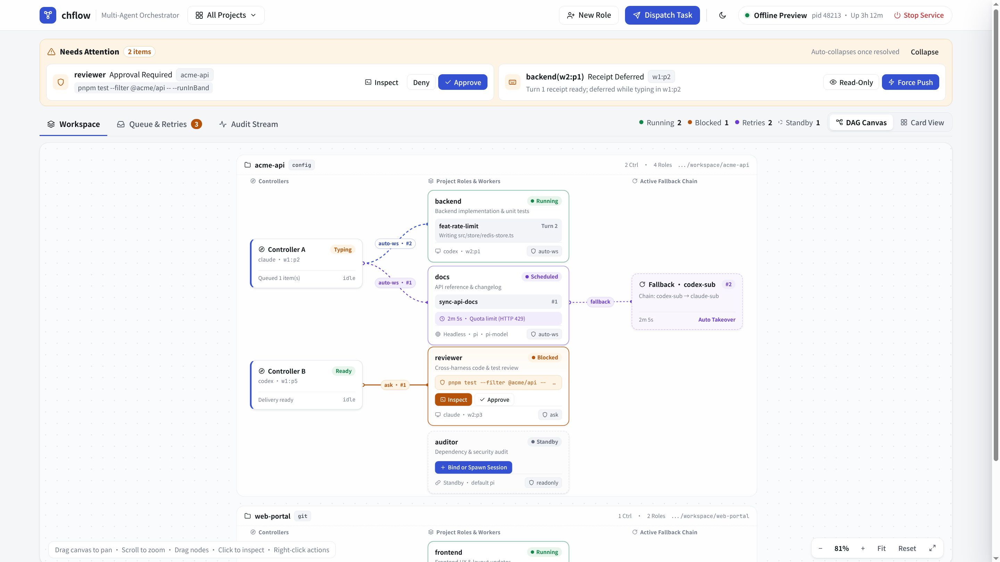

#  cross-harness-flow (`chflow`)

**Herdr-Based Multi-Project, Layered Role-Oriented Cross-Harness Agent Orchestrator**

[简体中文](./README.md) · English

[](#installation)
[](#dependencies--herdr-coupling)
[](#dependencies--herdr-coupling)
[](./LICENSE)

[Quick Start](#quick-start) · [Previews](#previews) · [Key Features](#key-features) · [Five Permission Tiers](#five-permission-tiers) · [Dependencies & Herdr Coupling](#dependencies--herdr-coupling) · [Installation](#installation) · [4-Layer Workflow & Global/Project Roles](#4-layer-workflow--globalproject-roles) · [Web Console & CLI Dashboard](#web-console--cli-dashboard) · [Project-Scoped MCP](#project-scoped-mcp)

---

`cross-harness-flow` is a reusable **Agent Skill + runtime (`chflow` v3.6.1)** fundamentally **designed around [Herdr](https://github.com/herdrdev/herdr)** for local multi-agent orchestration. Built on Herdr's multi-pane terminal control plane, it unifies **Pi, Codex, Claude Code, and Antigravity** across a 4-layer architecture (Intent Orchestration → Global/Project Roles → Hot-Swappable Sessions → Mailbox & Control Plane), enabling controller agents to derive roles and persistent sessions autonomously, hot-swap underlying Harnesses/models at any time, and keep five-tier permission governance, multi-turn history, pane navigation, and full visibility effortless in a pure monochrome Web/CLI console.

## Quick Start

### Starter Prompt for Your Controller Agent (Recommended)

Paste this prompt into any controller agent (Pi, Codex, Claude Code, or Antigravity) from any workspace to check/install dependencies and let it autonomously derive roles, persistent sessions, and dispatch workflows from your goal:

```text
Use cross-harness-flow (chflow) with Herdr to coordinate multi-agent work in my current workspace:
- Repo & setup docs: https://github.com/Raix2215/cross-harness-flow (interactive orchestration requires Herdr: https://github.com/herdrdev/herdr)
1. Check whether chflow, herdr, and the cross-harness-flow skill are installed locally; if missing, install them with user-level permissions from the repo (or Releases) per its README and load the skill.
2. Probe available Harnesses, live panes, and global role templates (chflow health / chflow role list --global), then autonomously derive project roles, five-tier permissions, and execution mode from my goal (Git edits default to auto-workspace + --worktree; non-Git directories use auto-workspace directly; review/research defaults to readonly; multi-turn collaboration uses persistent Herdr role panes, while one-shot read-only checks use headless chflow run) without interrogating me on routine settings.
3. Ask for confirmation only when yolo, cross-directory destructive actions, or missing/conflicting channels are involved; otherwise create/reuse roles, dispatch via the .chflow/ mailbox, verify outputs, and summarize deliverables.
```

### CLI Essentials

```sh
# 1. Define reusable global role templates (~/.config/chflow/roles.yaml; never clutters other projects)
chflow role set reviewer --global --kind claude --perm readonly --desc "Cross-harness code & security review"
chflow role list --global

# 2. Define project roles or lazily instantiate global templates and dispatch (5 perm tiers + selectable --workspace-mode)
chflow role set backend --kind codex --perm auto-workspace --workspace-mode workspace-write --worktree --desc "Backend implementation & tests"
chflow role bind backend --spawn
chflow send backend  --brief-file backend-brief.md
chflow send reviewer --spawn --brief-file review-brief.md --wait --timeout 180

# 3. Finish & prune (one-shot headless without Herdr: chflow run --kind codex --perm readonly --brief-file audit.md)
chflow finish <task-id> --ok --note "Review and regression checks passed" && chflow prune --tasks
```

---

## Previews

### Daemon-Embedded Pure Monochrome Role Topology Console (WebUI)

The embedded Web console starts automatically with the per-user Daemon (default `http://127.0.0.1:4317`, with automatic free-port fallback). Upgraded in v3.6 with a **pure black-and-white minimalist visual system (adaptive light/dark themes with muted semantic status accents)** and official split-pane SVG brand mark, it provides a **full-width zero-crossing DAG dispatch canvas & card-grid switcher**, **rich multi-controller cards & 3-tab controller drawer (`Overview` / `Workers` / `Activity`)**, **5-tier permission matrix with selectable Workspace Native Base**, **historical multi-turn task mailbox switching & Turn `N+1` continuation**, one-click Herdr pane focus, and an explicit topbar **"Stop Service"** button.



### Zero-Read-Screen CLI Live Status & Terminal Dashboard (`chflow` / `chflow top`)

Run `chflow` in an interactive terminal to inspect projects, role bindings, active tasks, live panes with human-readable names and Herdr locations, and the embedded WebUI URL. Run `chflow top` (or `chflow status -w`) for a push-driven live terminal dashboard without reading worker screens.


---

## Key Features

- **Five Permission Tiers & Selectable Workspace Native Base (`--workspace-mode`)**: Clearly distinguishes `readonly`, `ask`, **`auto` (Harness Native Auto — governed solely by the Harness with zero `chflow` keypresses)**, **`auto-workspace` (Workspace Auto + `chflow` permission guard with selectable native base per Harness)**, and `yolo` (filterless runtime passthrough skipping only user questions and 3-repeat loops). Command and path security stay owned natively by each Harness (no duplicate `chflow`-side command blacklist), and `activePromptText()` restricts prompt classification strictly to the active dialog.
- **Resilient Native Permission Restart, Auto-Rollback, Auto-Restart & Force-Interrupt (v3.6.1)**: Uses Harness-native exit commands (`/quit` for `pi`, `/exit` for `codex`/`claude`/`agy`) after clearing stray input drafts, escalates cleanly (`Esc`/`Ctrl+U` → `Ctrl+C`×2 → `Ctrl+D`) if exit stalls, shields panes/roles from sync pruning while preserving session IDs, retries transient launch errors, and **automatically rolls back** to the previous permission and conversation if the new launch fails. Supports `--auto-restart` (queues automatic idle restart when busy) and `--force` (force-interrupts working/blocked panes before restarting).
- **Two-Sample `stalled` Liveness Probe**: Routine monitoring stays strictly zero-screen-read. Before raising a `stalled` alert on a long-running active worker, the Daemon runs a two-sample liveness confirmation (`CHFLOW_STALL_CONFIRM_MS`, default `20000` ms) comparing bottom-20-line screen hashes plus `out`/local session file `mtime`, eliminating false stall alerts during active work.
- **Pure Monochrome WebUI, Rich Controller Drawer & Multi-Turn Historical Mailbox**: Features the monochrome split-pane SVG brand mark and adaptive favicon, zero emojis, SVG role badges (no `@` prefix noise), rich controller cards with quick DND toggle and 3-tab drawer, plus historical task switching, flicker-free Turn `1..N` mailbox inspection, and one-click Turn `N+1` continuation.
- **4-Layer Architecture & Two-Tier Roles (Global Templates + Project Instances)**: Persist reusable personal role presets (including `perm` and `workspace_mode`) in `~/.config/chflow/roles.yaml` (zero credentials) with `chflow role set <name> --global`. Global templates lazily instantiate into projects only on first `role bind` or `send --spawn`. Precedence: **per-dispatch flags > project role instance (incl. `.chflow/project.yaml`) > global role template > Skill scenario defaults**.
- **Human-Readable Session Naming & One-Click Herdr Focus**: Syncs Herdr `workspace` and `tab` labels so both WebUI and CLI display readable role names or `folder · Harness` with `Workspace / Tab` location subtitles, demoting raw pane IDs to copyable technical identifiers inside the drawer. Every live session supports one-click **Focus in Herdr** (`herdr agent focus`).
- **Stable Roles & Hot Session Swapping (`chflow role`)**: Decouple long-lived project responsibilities from transient Harness panes. Run `role bind` to hot-swap the underlying pane or switch to a headless runner while preserving the task thread (`--task`) and `.chflow/` mailbox history.
- **Context-Clean File Mailbox, Periodic Deferred Re-Delivery & Debounce Coalescing**: Briefs and deliverables are stored in workspace `.chflow/tasks/<task>/` (automatically ignored via `.git/info/exclude`), while wakeups inject only 3–5 plain-text lines. Receipts blocked by busy panes, typing, drafts, or interactive selections defer cleanly (`deferred_user_typing`), re-probe on a scheduled timer (`CHFLOW_DEFER_RETRY_MS`), and re-enter debounce coalescing once clear to deliver as a single merged batch.
- **Strict Live State Sync & Predictable Daemon Lifecycle**: Treats Herdr `agent list` as the live source of truth for exited/closed panes, supports two-tier idle auto-exit (`CHFLOW_IDLE_TIMEOUT_SEC` / `CHFLOW_UI_IDLE_TIMEOUT_SEC`), and offers explicit stop controls (`chflow stop` / `quit`, WebUI "Stop Service", and `x` twice in `chflow top`).
- **Smart Retries & Compliant Fallbacks**: Defaults to 4-step exponential backoff with `--retry-after` / `--at` scheduled recovery and ordered `--fallback` chains while separating attended (`--attended`) and unattended automation boundaries.

---

## Five Permission Tiers

| Tier (`--perm`) | Behavior & Native CLI Flags | `chflow` Auto-Approval Guard |
| --- | --- | --- |
| `readonly` | Read-only / Plan (`agy --mode plan`, `claude --permission-mode plan`, `codex -s read-only`, `pi --no-mcp --tools read,grep,find,ls`) | Off |
| `ask` | Interactive confirmation by the Harness (default) | Off |
| `auto` | **Harness Native Auto** (`agy --mode auto`, `claude --permission-mode auto`, `codex --approve-for-me`, `pi` default); reports `restart_required` if the running pane was not launched natively in `auto` | **Strictly Off (zero keypresses)** |
| `auto-workspace` | **Workspace Auto**: selectable native base via `--workspace-mode` — `agy`/`claude` default `accept-edits` (or `auto`), `codex` default `workspace-write` (or `approve-for-me`) | **On**: approves active permission dialogs only; skips user questions, unsafe selections, and 3-repeat loops |
| `yolo` | Native skip-permissions flags (`--dangerously-skip-permissions` / `--dangerously-bypass-approvals-and-sandbox`); explicit authorization or external isolation only | **On (filterless passthrough)**: skips only user questions, native `readonly`, and 3-repeat loops |

---

## Dependencies & Herdr Coupling

Interactive orchestration in `cross-harness-flow` is **built directly on [Herdr](https://github.com/herdrdev/herdr)**. The `chflow` runtime itself uses only the Node.js standard library (including built-in SQLite) with no third-party npm runtime dependencies:

| Dependency | Version | Required | Role & Coupling Boundary |
| --- | --- | --- | --- |
| **[Herdr](https://github.com/herdrdev/herdr)** | `>= 0.9.5` | **Required for interactive orchestration** (optional for headless mode) | Manages interactive multi-pane terminal sessions, workspace/tab label discovery, status probing, pane focusing, text injection, controlled keypresses, and cross-host SSH routing. All Herdr calls are isolated in a single adapter: [`packages/chflow/src/herdr.ts`](./packages/chflow/src/herdr.ts). |
| **Node.js** | `>= 22.13.0` | **Required** | Runs the `chflow` CLI, per-user Daemon, SQLite store, Stdio MCP server, and embedded WebUI. |
| **Harness CLI** | Authenticated | **As needed** | At least one target agent CLI (`codex`, `claude`, `pi`, or `agy`) available on `PATH`. |

> **What runs without Herdr?**
> Even without Herdr installed or running, one-shot/background headless runs (`chflow run --kind codex|claude|pi`), `chflow daemon`, SQLite state persistence, `.chflow/` file mailboxes, and the embedded Web console operate standalone.

---

## Repository Layout

```text
cross-harness-flow/
├── README.md                              # Chinese documentation (default)
├── README.en.md                           # English documentation
├── LICENSE                                # MIT License
├── assets/
│   ├── logo.svg                           # Official monochrome split-pane SVG logo (light/dark adaptive)
│   ├── webui-preview.png                  # Pure monochrome WebUI preview (Chinese)
│   ├── webui-preview-en.png               # Pure monochrome WebUI preview (English)
│   ├── cli-dashboard.png                  # CLI live status dashboard preview (Chinese)
│   └── cli-dashboard-en.png               # CLI live status dashboard preview (English)
├── packages/chflow/                       # chflow v3.6.1 runtime source & black-box E2E suite
│   ├── LICENSE
│   ├── README.md
│   ├── package.json
│   ├── src/                               # TypeScript source
│   └── e2e/                               # Process-level black-box E2E & packaging checks
├── skills/
│   ├── README.md                          # Skill directory overview
│   ├── cross-harness-flow.skill           # Distributable Skill ZIP archive
│   └── cross-harness-flow/
│       ├── SKILL.md                       # Cross-Harness orchestration skill entrypoint
│       └── references/operations.md       # Command reference, MCP templates & troubleshooting
└── templates/
    └── matrix.template.yaml               # Sanitized multi-channel routing matrix template (v2)
```

---

## Installation

### 1. Install the `chflow` Runtime (User Permissions, No `sudo`)

```sh
cd packages/chflow
npm ci
npm run build
npm install -g --prefix "$HOME/.local" .
```

Ensure `$HOME/.local/bin` is on `PATH`. With **pnpm (including pnpm 12+)** and a user-configured global bin directory, pack first and install offline:

```sh
cd packages/chflow
npm ci && npm run build && npm pack
pnpm add -g --offline ./chflow-3.6.1.tgz
```

For cross-machine offline distribution, copy `chflow-3.6.1.tgz` to the target host and run:

```sh
# Linux / Unix
npm install --offline -g --prefix "$HOME/.local" ./chflow-3.6.1.tgz

# Windows (PowerShell, with a user-writable npm prefix on PATH)
npm install --offline -g .\chflow-3.6.1.tgz
```

### 2. Install the Skill

Copy [`skills/cross-harness-flow/`](./skills/cross-harness-flow/) (or extract [`skills/cross-harness-flow.skill`](./skills/cross-harness-flow.skill)) into your host's Skill directory (compatible with Pi, Codex, Claude Code, and Antigravity).

### 3. Verify Installation

```sh
chflow --version
chflow health
```

---

## 4-Layer Workflow & Global/Project Roles

| Layer | Responsibility | Backing Component |
| --- | --- | --- |
| **1. Intent Orchestration** | Breaks down goals and derives roles, five-tier permissions, and persistent vs. headless execution | Controller Agent + `cross-harness-flow` Skill |
| **2. Project & Role Layer** | Stores reusable global templates and lazily instantiates isolated per-project roles | `~/.config/chflow/roles.yaml` + project roles / `.chflow/project.yaml` |
| **3. Session & Execution** | Binds roles to hot-swappable persistent Herdr panes or one-shot headless runs | Herdr panes / `chflow run` |
| **4. Mailbox & Control Plane** | Context-clean `.chflow/` exchange, deferred periodic delivery, liveness verification & human control | `.chflow/` mailbox + Daemon + WebUI / CLI |

### Global Role Templates (`~/.config/chflow/roles.yaml`)

Use `--global` to store personal cross-project role presets (override location via `CHFLOW_CONFIG_DIR` or `XDG_CONFIG_HOME`; never store secrets or emails):

```sh
chflow role set reviewer --global --kind claude --perm readonly --desc "Cross-harness code review"
chflow role set backend  --global --kind codex  --perm auto-workspace --workspace-mode workspace-write --worktree --desc "Backend implementation & tests"
```

- Global templates **never auto-clutter untouched projects**; they lazily instantiate into a project only on first `chflow role bind <name>`, `chflow send <name> --spawn`, or when selected and saved in the WebUI New Role modal.
- Project-level edits stay scoped to that project; update global templates explicitly with `--global` or the WebUI "Also save as global role template" checkbox.

### Optional Project Manifest (`.chflow/project.yaml`)

Place an optional `.chflow/project.yaml` at your repository root (metadata only) to pin the project identity, group linked worktrees, and preload team role slots:

```yaml
project: acme-api
name: Acme API
roles:
  backend:
    description: Core backend implementation and integration tests
    kind: codex
    perm: auto-workspace
    workspace_mode: workspace-write
    worktree: true
  reviewer:
    description: Cross-harness security and diff review
    kind: claude
    perm: readonly
```

- Without `.chflow/project.yaml`, `chflow` automatically groups sessions by **Git linked worktree → normalized working directory**.
- Calling `chflow send <role>` on an `unbound` role returns `role_unbound` by default to prevent accidental quota spend; pass `--spawn` explicitly to launch and bind from the project role or global template.

---

## Web Console & CLI Dashboard

- **Always-On Embedded WebUI**: Starts automatically with the Daemon at `http://127.0.0.1:4317` (falling back to a free port on conflict).
- **Interactive CLI Controls**:
  - `chflow` / `chflow status [--project ID]`: compact colored global status and WebUI URL
  - `chflow top [--project ID]`: push-driven live terminal dashboard (`q` quit, `o` open WebUI, `a` approve block, `p` switch perm, `f` flush queue, `r` refresh, `x` twice to stop Daemon)
  - `chflow stop [--force]` / `chflow quit`: explicitly stop the background Daemon (guards active tasks unless `--force`)
  - `chflow open` / `chflow ui --open`: launch the embedded console in your default browser
  - `chflow approve` / `perm` / `queue` / `view`: human TTY-only operator shortcuts
- **Secure LAN / Tailnet Access**:
  - Launch a temporary standalone listener (leaves the shared Daemon unchanged):
    ```sh
    chflow ui --host 0.0.0.0 --allow-remote
    ```
  - Switch the shared Daemon to remote listening (confirm no active tasks first, stop the Daemon, then restart with environment variables):
    ```sh
    chflow daemon stop
    CHFLOW_UI_HOST=0.0.0.0 CHFLOW_UI_ALLOW_REMOTE=1 chflow daemon start
    ```
  - Non-loopback binding enforces a 48-hex-character Access Token, `HttpOnly; SameSite=Strict` cookie sessions, and strict `Host` / `Origin` / CSRF checks. **Security Note**: printed `?token=...` URLs are reusable access credentials — use them only on trusted networks and never share or log them publicly.

---

## Project-Scoped MCP

`chflow mcp` exposes a compact Stdio MCP proxy sharing the same Daemon (**19 default core tools**, including `flow_role` with `--global` template & `workspace_mode` support, `flow_adopt`, `flow_handoff`, `flow_inbox`, and `flow_flush`). The high-risk keypress tool `flow_respond` stays hidden unless explicitly enabled with `--enable-respond`.

<details>
<summary><b>Claude Code (<code>.mcp.json</code>) & Antigravity (<code>.agents/plugins/</code>)</b></summary>

```json
{
  "mcpServers": {
    "cross-harness-flow": {
      "command": "chflow",
      "args": ["mcp"]
    }
  }
}
```

For Antigravity, include `plugin.json` alongside it: `{ "name": "cross-harness-flow" }`.

</details>

<details>
<summary><b>Codex (<code>.codex/config.toml</code>)</b></summary>

```toml
[mcp_servers.cross_harness_flow]
command = "chflow"
args = ["mcp"]
```

</details>

<details>
<summary><b>Pi (<code>.pi/mcp.json</code>)</b></summary>

```json
{
  "mcpServers": {
    "cross-harness-flow": {
      "command": "chflow",
      "args": ["mcp"],
      "exposure": "codemode"
    }
  }
}
```

</details>

See [skills/cross-harness-flow/references/operations.md](./skills/cross-harness-flow/references/operations.md) for complete host setup and troubleshooting.

---

## Security & Compliance

- **Zero Credential Persistence**: [`templates/matrix.template.yaml`](./templates/matrix.template.yaml), `~/.config/chflow/roles.yaml`, and `.chflow/` mailboxes store only logical channel IDs and capabilities; built-in sensitive-input guards block literal API keys, tokens, cookies, and emails.
- **Human-in-the-Loop Boundary**: Explicitly separates attended interactive sessions (`--attended`) from unattended automation; consumer interactive OAuth channels stay attended-only and are excluded from `--unattended`, `--bg`, automatic retries, and automatic fallback chains.
- **Harness-Native Security + Five Permission Tiers**: Command and path safety stay enforced natively by each Harness; `chflow` coordinates `readonly`, `ask`, `auto` (native auto, zero keypresses), `auto-workspace` (selectable native base + permission guard), and `yolo` (explicit authorization or external isolation only) while protecting user questions from accidental submission.

---

## Verification

```sh
cd packages/chflow
npm ci
npm run build
npm run test:e2e
npm run pack:check
```

## License

[MIT](./LICENSE)
