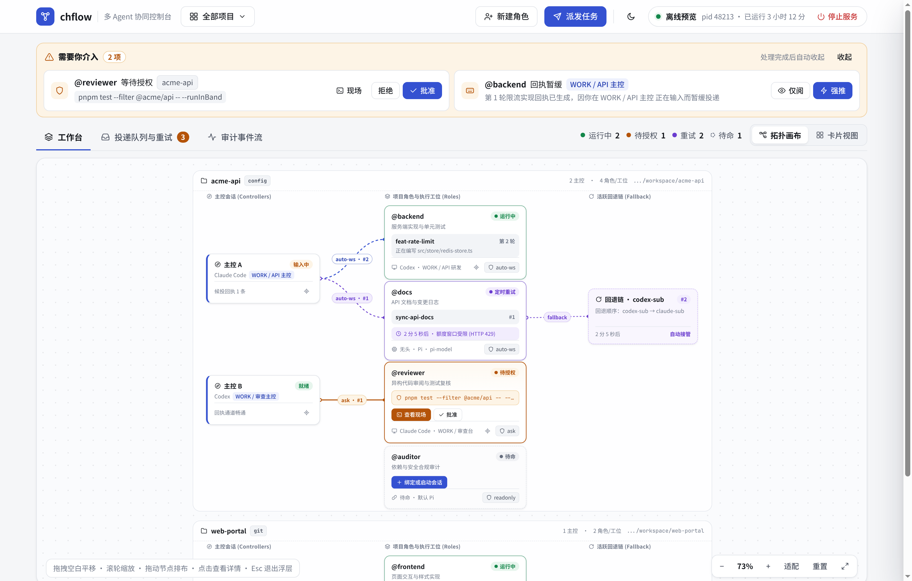
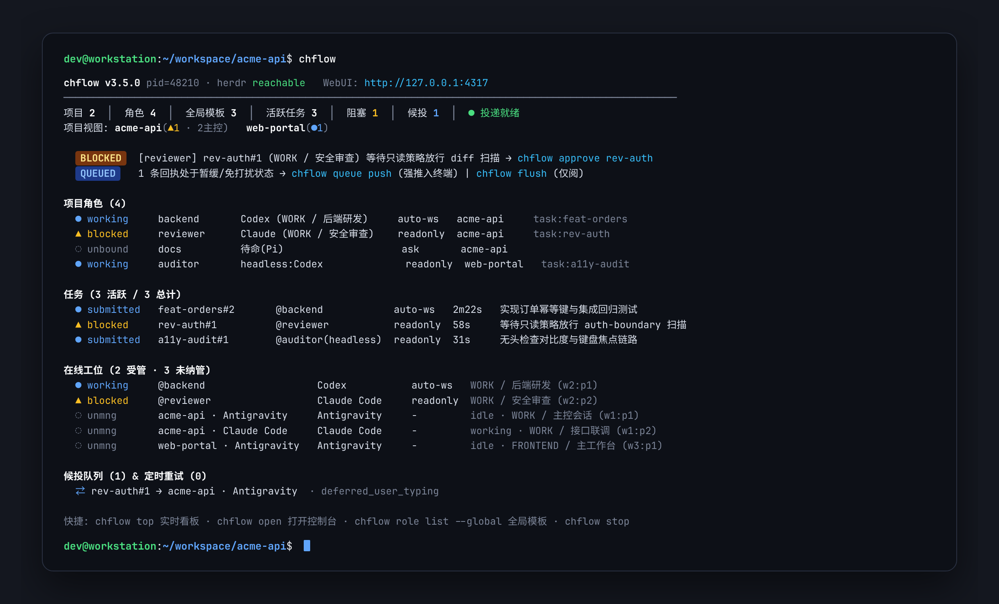

# cross-harness-flow (`chflow`)

**基于 [Herdr](https://github.com/herdrdev/herdr) 的多项目、分层角色化跨 Harness Agent 协同工作流**

简体中文 · [English](./README.en.md)

[](#安装)
[](#依赖与-herdr-耦合说明)
[](#依赖与-herdr-耦合说明)
[](./LICENSE)

[快速上手](#快速上手) · [界面预览](#界面预览) · [核心特性](#核心特性) · [依赖与 Herdr 耦合说明](#依赖与-herdr-耦合说明) · [安装](#安装) · [四层工作流与全局/项目角色](#四层工作流与全局项目角色) · [Web 控制台与 CLI 看板](#web-控制台与-cli-看板) · [项目级 MCP](#项目级-mcp)

---

`cross-harness-flow` 是一套**以 [Herdr](https://github.com/herdrdev/herdr) 为核心构建**的本地多 Agent 协同 **通用 Skill 与运行时（`chflow` v3.5.0）**。它依托 Herdr 的多窗格终端控制面，将 **Pi、Codex、Claude Code、Antigravity** 统一到四层协同体系中（意图编排 → 全局/项目角色 → 可热替换会话 → 信箱与控制面），让主控 Agent 能按场景自动建立角色与持久会话、随时热替换底层 Harness/模型，同时通过高可读的实时 Web/CLI 控制台将关键审批、窗格定位与全局观测权留给人类。

## 快速上手

### 直接发给主控 Agent（推荐）

在任意工作区复制下面这段提示词给主控 Agent（Pi / Codex / Claude Code / Antigravity），即可自动检查安装并按你的任务目标自主推导角色、建立持久会话与完成派发：

```text
请使用 cross-harness-flow（chflow）配合 Herdr，在当前工作区协助我开展多 Agent 协同：
- 项目与安装文档：https://github.com/Raix2215/cross-harness-flow（交互编排依赖 Herdr：https://github.com/herdrdev/herdr）
1. 先检查本机是否已安装 chflow、herdr 及 cross-harness-flow Skill；若缺失，请从上述仓库（或 Releases）按 README 的用户权限方式协助安装并加载 Skill。
2. 探测本机可用的 Harness、在线工位与全局角色模板（chflow health / chflow role list --global），结合我的任务目标自主推导角色分工、权限与执行形态（Git 代码改动默认 auto-workspace + --worktree，非 Git 目录直接当前目录 auto-workspace，审查/调研默认 readonly；多轮协作建持久 Herdr 角色窗格，一次性只读核查走无头 chflow run），无需逐项追问常规配置。
3. 仅在涉及 yolo、跨目录破坏性操作或缺少可用渠道时先向我确认；其余情况直接建/复用角色并通过 .chflow/ 信箱派发、核验与汇总交付。
```

### 常用 CLI 流程

```sh
# 1. 沉淀可复用的全局角色模板（写入 ~/.config/chflow/roles.yaml，不污染其他项目画布）
chflow role set reviewer --global --kind claude --perm readonly --desc "异构代码与安全审查"
chflow role list --global

# 2. 定义项目角色或直接懒实例化全局模板并派发（支持随时 role bind --spawn 热替换会话/模型）
chflow role set backend --kind codex --perm auto-workspace --worktree --desc "后端实现与测试"
chflow role bind backend --spawn
chflow send backend  --brief-file backend-brief.md
chflow send reviewer --spawn --brief-file review-brief.md --wait --timeout 180

# 3. 验收结单并清理（一次性无头任务无需 Herdr：chflow run --kind codex --perm readonly --brief-file audit.md）
chflow finish <task-id> --ok --note "审查与回归全部通过" && chflow prune --tasks
```

---

## 界面预览

### 随 Daemon 常驻的多项目角色拓扑控制台（WebUI）

内置控制台随每用户 Daemon 自动启动（默认 `http://127.0.0.1:4317`，端口冲突自动回退）。采用百分比宽屏布局、清晰大字号与统一线性 SVG 图标（零 Emoji），提供**全宽零交叉 DAG 派发画布 / 卡片视图双切换**、**高可读的 Herdr 会话命名与 `工作区 / 标签页` 定位跳转**、全视图一致展示的外部在线会话区、全局模板一键填充/沉淀弹窗、滑出式角色详情抽屉以及顶栏显式 **「停止服务」** 按钮。



### 零读屏 CLI 实时状态与终端看板（`chflow` / `chflow top`）

在交互终端直接运行 `chflow` 即可查看多项目摘要、稳定角色绑定、活跃任务、带可读名称与 Herdr 位置的在线工位及控制台地址；运行 `chflow top`（或 `chflow status -w`）进入基于 Daemon 事件推送的零读屏实时看板。



---

## 核心特性

- **四层协同与两级角色模型（全局模板 + 项目实例）**：通过 `chflow role set <name> --global` 将通用角色预设沉淀到 `~/.config/chflow/roles.yaml`（零凭据）；全局模板不会污染未使用的项目，仅在项目首次 `role bind` 或 `send --spawn` 时自动懒实例化。覆盖遵循四级优先级：**单次派发参数 > 项目角色实例（含 `.chflow/project.yaml`）> 全局角色模板 > Skill 场景默认值**。
- **高自主编排 Skill**：主控 Agent 主动探测本机 Harness、在线工位与全局模板，自动按场景分流权限与形态（Git 代码改动走 `auto-workspace` + `--worktree`，非 Git 目录直接当前目录 `auto-workspace`，审查/调研走 `readonly`；多轮协作建持久 Herdr 窗格，一次性只读核查走无头 `chflow run`），仅对高危或缺失渠道请求确认。
- **高可读会话标识与一键定位 Herdr 窗格**：后端自动同步 Herdr `workspace` / `tab` 标签，WebUI 与 CLI 统一展示 `@角色` 或 `目录名 · Harness`（附 `工作区 / 标签页` 副标题），将 `w1:p2Z` 这类底层编号退为抽屉内可复制的技术 ID；所有在线工位支持在 WebUI 一键聚焦跳转到对应 Herdr 窗格（`herdr agent focus`），且未纳管在线会话在 DAG 与卡片视图下均一致可见、可直接派发或绑定。
- **稳定角色与会话热替换（`chflow role`）**：把“项目固定分工”与“底层运行中的 Harness 窗格”解耦。额度耗尽或需切换模型时，直接 `role bind` 热替换底层窗格或切至无头执行器，原有任务线程（`--task`）与 `.chflow/` 信箱历史无缝延续。
- **多项目与多主控视图（`--project`）**：三层项目归组优先级——显式指定（`--project` / WebUI 归组 / 可选 `.chflow/project.yaml`）> Git 关联工作树自动合并到主仓库（独立嵌套仓库保持独立）> 工作目录兜底。同一项目天然支持多个主控会话并发工作、各自独立接收回执。
- **与 Herdr 实时状态强同步**：以 Herdr `agent list`（`pane_id` + `terminal_id` + 在线运行态）为真值；无论是关闭窗格还是窗格内会话已退出（`exited` 但窗格未关），均即时同步移出临时窗格、将绑定角色回退为 `unbound` 待命，有活跃任务的离线窗格显式标为 `offline`，并支持 `chflow prune [--tasks]` 手动整理。
- **可控的 Daemon 生命周期与显式退出**：支持双层空闲自动退出——无客户端静置满 `CHFLOW_IDLE_TIMEOUT_SEC`（默认 30 分钟），或仅剩浏览器被动 WebUI 标签页且无任何在线会话与活跃任务静置满 `CHFLOW_UI_IDLE_TIMEOUT_SEC`（默认 60 分钟）时，Daemon 主动推送 `shutdown` 事件优雅退出且前端不再死循环重连；同时支持 `chflow stop` / `chflow quit`（活跃任务保护 + `--force`）、WebUI 顶栏「停止服务」按钮及 `chflow top` 快捷键 `x` 显式停机。
- **零上下文污染的文件信箱与防打断投递**：长文本任务书与交付正文全部落盘工作区 `.chflow/tasks/<task>/t<N>-brief.md` 与 `t<N>-reply.md`（Git 仓库自动通过 `.git/info/exclude` 忽略），跨会话唤醒仅传递 3–5 行纯文本路由与路径；收件窗格忙时自动入队防抖合并，检测到用户聚焦打字或底部草稿时自动暂缓（`deferred_user_typing`），常规监看零读屏。
- **智能重试与合规回退链**：默认提供 4 档指数退避重试，支持 `--retry-after` / `--at` 定时恢复与 `--fallback` 有序回退链（自动排除主渠道自身，且 WebUI 仅在实际进入 `retrying` / `scheduled_retry` 时展示回退节点），显式区分人机交互（`--attended`）与无人值守自动化边界。

---

## 依赖与 Herdr 耦合说明

`cross-harness-flow` 的交互协同体系**围绕 [Herdr](https://github.com/herdrdev/herdr) 构建**；运行时 `chflow` 本身基于 Node.js 标准库（含内置 SQLite），无第三方 npm 运行时依赖。各组件边界如下：

| 依赖组件                                            | 版本要求       | 是否必需                               | 作用与耦合边界                                                                                                                                                                             |
| --------------------------------------------------- | -------------- | -------------------------------------- | ------------------------------------------------------------------------------------------------------------------------------------------------------------------------------------------ |
| **[Herdr](https://github.com/herdrdev/herdr)** | `>= 0.9.5`   | **交互编排必需**（无头模式可选） | 负责交互式多窗格终端会话的创建、纳管、工作区/标签页元数据读取、状态探测、窗口聚焦、文本注入、受控按键与跨机 SSH 路由。全部 Herdr 交互逻辑隔离在单一适配层 [`packages/chflow/src/herdr.ts`](./packages/chflow/src/herdr.ts)。 |
| **Node.js**                                   | `>= 22.13.0` | **必需**                         | 运行 `chflow` CLI、每用户常驻 Daemon、SQLite 状态库、MCP 服务与内置 Web 控制台。                                                                                                         |
| **Harness CLI**                               | 已登录/可用    | **按需必需**                     | 至少安装一个目标代理 CLI（`codex`、`claude`、`pi`、`agy`）并位于 `PATH`。                                                                                                     |

> **哪些能力可脱离 Herdr 独立运行？**
> 未安装或未启动 Herdr 时，`chflow run --kind codex|claude|pi`（一次性/后台无头任务）、`chflow daemon`、SQLite 状态库、`.chflow/` 文件信箱以及内置 Web 控制台仍可独立运行。

---

## 仓库结构

```text
cross-harness-flow/
├── README.md                              # 中文说明（默认）
├── README.en.md                           # 英文说明
├── LICENSE                                # MIT 开源协议
├── assets/
│   ├── webui-preview.png                  # Web 控制台多项目与角色拓扑预览（中文）
│   ├── webui-preview-en.png               # Web 控制台多项目与角色拓扑预览（英文）
│   ├── cli-dashboard.png                  # CLI 实时状态看板预览（中文）
│   └── cli-dashboard-en.png               # CLI 实时状态看板预览（英文）
├── packages/chflow/                       # chflow v3.5.0 运行时源码与黑盒 E2E 套件
│   ├── LICENSE
│   ├── README.md
│   ├── package.json
│   ├── src/                               # TypeScript 源码
│   └── e2e/                               # 全黑盒 E2E 与离线打包校验
├── skills/
│   ├── README.md                          # Skill 目录说明
│   ├── cross-harness-flow.skill           # 可直接分发的标准 Skill ZIP 包
│   └── cross-harness-flow/
│       ├── SKILL.md                       # 跨 Harness 编排 Skill 入口
│       └── references/operations.md       # 完整命令速查、MCP 模板与排障手册
└── templates/
    └── matrix.template.yaml               # 脱敏多渠道路由矩阵模板（v2）
```

---

## 安装

### 1. 安装 `chflow` 运行时（用户权限，无需 `sudo`）

```sh
cd packages/chflow
npm ci
npm run build
npm install -g --prefix "$HOME/.local" .
```

将 `$HOME/.local/bin` 加入 `PATH`。若使用 **pnpm（含 pnpm 12+）** 且已配置用户级全局目录，先打包再离线安装：

```sh
cd packages/chflow
npm ci && npm run build && npm pack
pnpm add -g --offline ./chflow-3.5.0.tgz
```

跨机离线分发只需复制 `chflow-3.5.0.tgz` 到目标机并执行：

```sh
# Linux / Unix
npm install --offline -g --prefix "$HOME/.local" ./chflow-3.5.0.tgz

# Windows（PowerShell，确保用户级 npm prefix 位于 PATH）
npm install --offline -g .\chflow-3.5.0.tgz
```

### 2. 安装 Skill 文档

将 [`skills/cross-harness-flow/`](./skills/cross-harness-flow/)（或解压 [`skills/cross-harness-flow.skill`](./skills/cross-harness-flow.skill)）放入宿主的 Skill 目录即可（支持 Pi / Codex / Claude Code / Antigravity）。

### 3. 验证安装

```sh
chflow --version
chflow health
```

---

## 四层工作流与全局/项目角色

| 层级 | 职责 | 载体 |
| --- | --- | --- |
| **① 意图编排层** | 拆解目标，按场景自主推导角色分工、权限与持久/无头形态 | 主控 Agent + `cross-harness-flow` Skill |
| **② 项目与角色层** | 全局角色模板沉淀复用，项目内按需懒实例化并维持独立配置 | `~/.config/chflow/roles.yaml` + 项目角色 / `.chflow/project.yaml` |
| **③ 会话与执行层** | 角色绑定到可热替换的 Herdr 持久窗格或一次性无头执行器 | Herdr 多窗格会话 / `chflow run` |
| **④ 信箱与控制面** | 文件信箱防污染交接、防打断投递、实时观测与人类快捷接管 | `.chflow/` 信箱 + 常驻 Daemon + WebUI / CLI |

### 全局角色模板（`~/.config/chflow/roles.yaml`）

用 `--global` 定义跨项目复用的个人角色模板（支持 `CHFLOW_CONFIG_DIR` 或 `XDG_CONFIG_HOME` 覆盖路径，严禁写入密钥或账号）：

```sh
chflow role set reviewer --global --kind claude --perm readonly --desc "异构代码审查"
chflow role set backend  --global --kind codex  --perm auto-workspace --worktree --desc "后端实现与回归"
```

- 全局模板**不会自动塞进所有项目的画布**；仅当你或主控 Agent 在某项目执行 `chflow role bind reviewer`、`chflow send reviewer --spawn`，或在 WebUI 新建角色弹窗从模板一键填充保存时，才会懒实例化为该项目角色。
- 项目级覆盖不会反写全局模板；若要修改全局预设，显式传 `--global` 或勾选 WebUI 中的「同时保存为全局角色模板」。

### 可选项目声明文件（`.chflow/project.yaml`）

在仓库根目录放置可选 `.chflow/project.yaml`（纯元数据），即可统一项目名、关联工作树并预载团队角色槽位：

```yaml
project: acme-api
name: Acme API
roles:
  backend:
    description: 后端核心实现与回归测试
    kind: codex
    perm: auto-workspace
    worktree: true
  reviewer:
    description: 异构安全与 Diff 审查
    kind: claude
    perm: readonly
```

- 未声明 `.chflow/project.yaml` 时，`chflow` 自动按 **Git 关联工作树 → 规范化工作目录** 归组项目，无需额外配置。
- 向处于 `unbound` 待命状态的角色直接 `send` 时，默认返回 `role_unbound` 安全拦截，防止静默误拉起消耗额度；显式追加 `--spawn` 即可按项目角色或全局模板一键拉起并派发。

---

## Web 控制台与 CLI 看板

- **随 Daemon 自动常驻**：首次执行任意业务命令时，Daemon 自动在 `http://127.0.0.1:4317` 启动内置 Web 控制台（端口冲突自动回退空闲端口）。
- **常用终端快捷命令**：
  - `chflow` / `chflow status [--project ID]`：彩色紧凑全局状态与 Web 控制台地址
  - `chflow top [--project ID]`：基于 Daemon 推送的实时终端看板（`q` 退出、`o` 开控制台、`a` 放行阻塞、`p` 切权限、`f` 消费队列、`r` 刷新、`x` 两次确认停止 Daemon）
  - `chflow stop [--force]` / `chflow quit`：显式停止常驻 Daemon（存在活跃任务时默认拦截提示）
  - `chflow open` / `chflow ui --open`：用系统浏览器打开内置控制台
  - `chflow approve` / `perm` / `queue` / `view`：人类交互终端专属快捷接管命令
- **局域网 / Tailnet 跨设备安全访问**：
  - 启动临时独立实例（不影响常驻 Daemon）：
    ```sh
    chflow ui --host 0.0.0.0 --allow-remote
    ```
  - 切换常驻 Daemon 监听到远程地址（须先确认无进行中任务，再停机并携带环境变量重启）：
    ```sh
    chflow daemon stop
    CHFLOW_UI_HOST=0.0.0.0 CHFLOW_UI_ALLOW_REMOTE=1 chflow daemon start
    ```
  - 非回环绑定强制启用随机 48 位十六进制访问令牌、`HttpOnly; SameSite=Strict` Cookie 会话与 `Host` / `Origin` / CSRF 白名单校验。**注意**：终端打印的带 `?token=...` 链接属于可复用的访问凭据，仅限受信任网络内本人使用，切勿公开分享或写入日志。

---

## 项目级 MCP

`chflow mcp` 是复用同一 Daemon 的 Stdio 薄代理，默认暴露 **19 个紧凑核心工具**（含支持 `--global` 模板的 `flow_role`，以及 `flow_adopt`、`flow_handoff`、`flow_inbox`、`flow_flush`），高风险按键工具 `flow_respond` 默认隐藏（仅显式 `--enable-respond` 开启）。

<details>
<summary><b>Claude Code（<code>.mcp.json</code>）与 Antigravity（<code>.agents/plugins/</code>）配置</b></summary>

```json
{
  "mcpServers": {
    "cross-harness-flow": {
      "command": "chflow",
      "args": ["mcp"]
    }
  }
}
```

Antigravity 同目录附带 `plugin.json`：`{ "name": "cross-harness-flow" }`。

</details>

<details>
<summary><b>Codex（<code>.codex/config.toml</code>）配置</b></summary>

```toml
[mcp_servers.cross_harness_flow]
command = "chflow"
args = ["mcp"]
```

</details>

<details>
<summary><b>Pi（<code>.pi/mcp.json</code>）配置</b></summary>

```json
{
  "mcpServers": {
    "cross-harness-flow": {
      "command": "chflow",
      "args": ["mcp"],
      "exposure": "codemode"
    }
  }
}
```

</details>

完整宿主接入与排障说明见 [skills/cross-harness-flow/references/operations.md](./skills/cross-harness-flow/references/operations.md)。

---

## 安全与合规边界

- **凭据零落盘**：[`templates/matrix.template.yaml`](./templates/matrix.template.yaml)、`~/.config/chflow/roles.yaml` 与 `.chflow/` 信箱仅保存逻辑渠道名与能力属性；运行时内置敏感内容扫描拦截明文 Key、Token、Cookie 与邮箱泄漏。
- **人机边界**：显式区分有人在场交互（`--attended`）与无人值守自动化阶段，消费级交互渠道默认保持在场交互，不自动进入 `--unattended`、`--bg`、自动重试或自动回退链。
- **四档受控权限**：`readonly` / `ask`（默认） / `auto-workspace`（自动筛查拒绝高危命令） / `yolo`（需明确授权或外部隔离）。

---

## 本地校验

```sh
cd packages/chflow
npm ci
npm run build
npm run test:e2e
npm run pack:check
```

## 开源协议

[MIT](./LICENSE)
